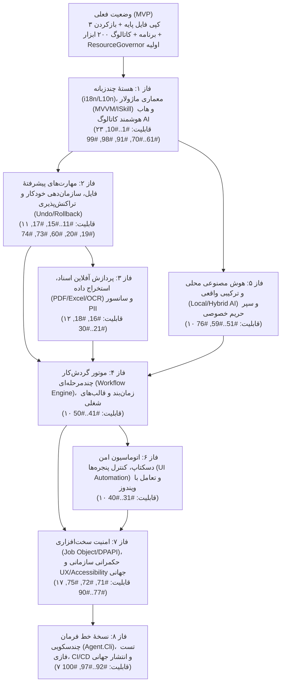
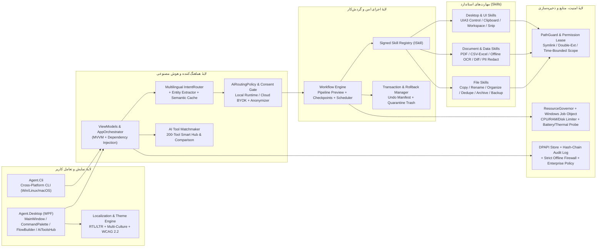

# نقشهٔ راه بین‌المللی‌سازی، معماری کدنویسی و فازبندی ۱۰۰ قابلیت «رباتیک ایجنت»

این سند، نقشهٔ راه مهندسی و اجرایی برای تبدیل **«رباتیک ایجنت»** از یک MVP محلیِ تک‌مهارتی به یک **نرم‌افزار بین‌المللی، چندزبانه، امن و محلی‌محور (Local-First & Hybrid)** است. تمامی **۱۰۰ قابلیت پیشنهادی** بر اساس وابستگی‌های فنی در **۸ فاز منطقی و قابلِ پیاده‌سازی** دسته‌بندی شده‌اند.

---

## ۱. خلاصهٔ نیاز جهانی و ارزش پیشنهادی محصول

بر اساس داده‌های پژوهشی جهانی (WORKBank استنفورد، OECD، Deloitte و گزارش‌های SMB):
1. **حذف کارهای تکراریِ فایل و سند بدون از دست رفتن کنترل انسان:** کاربران می‌خواهند کارهای فرسایندهٔ مرتب‌سازی فایل، تغییر نام، استخراج جدول و فاکتور، و گزارش‌گیری خودکار شود، اما تصمیم نهایی با **پیش‌نمایش (Preview) و تأیید انسانی (Human-in-the-Loop)** در دست خودشان بماند.
2. **حفظ حریم خصوصی و جلوگیری از نشت داده در ابزارهای ابری:** پردازش پیش‌فرض روی دستگاه کاربر (`LocalOnly`) انجام می‌شود و در حالت `Hybrid`، پیش از ارسال هر داده به API بیرونی، اطلاعات حساس ناشناس‌سازی شده و رضایت صریح برای همان تسک گرفته می‌شود.
3. **رفع سردرگمی بین صدها ابزار هوش مصنوعی و کمبود مهارت فنی:** ترکیب دستیار اجرایی دسکتاپ با یک هاب هوشمند انتخاب ابزار و قالب‌های آمادهٔ شغلی (۱-کلیکی) به زبان مادری کاربر.
4. **اجرا روی سخت‌افزارهای عادی و لپ‌تاپ‌های باتری‌محور:** رعایت بودجهٔ سخت‌افزاری با `ResourceGovernor` و اعمال محدودیت واقعی مصرف منابع.

---

## ۲. گراف وابستگی فازهای اجرایی (Phase Dependency Graph)

### نمودار Mermaid فازها



### گراف متنی ترتیب و وابستگی فازها

```text
                           ┌──────────────────────────────────────────┐
                           │             وضعیت فعلی (MVP)             │
                           └────────────────────┬─────────────────────┘
                                                │
                                                ▼
      ┌───────────────────────────────────────────────────────────────────────────────────┐
      │ فاز ۱: زیرساخت چندزبانه (i18n/RTL-LTR) + قرارداد ISkill/MVVM + هاب هوشمند کاتالوگ │
      └───────────────────┬───────────────────────────────────────────┬───────────────────┘
                          │                                           │
                          ▼                                           ▼
┌───────────────────────────────────────────────────┐   ┌───────────────────────────────────────────────────┐
│ فاز ۲: مهارت‌های پیشرفتهٔ فایل + Undo/Rollback     │   │ فاز ۵: موتور AI محلی/ترکیبی + ناشناس‌ساز داده      │
└───────────────────┬───────────────────────────────┘   └─────────────────────┬─────────────────────────────┘
                    │                                                         │
                    ▼                                                         │
┌───────────────────────────────────────────────────┐                         │
│ فاز ۳: پردازش آفلاین اسناد (PDF/CSV/OCR/PII)       │                         │
└───────────────────┬───────────────────────────────┘                         │
                    │                                                         │
                    └───────────────────────────┬─────────────────────────────┘
                                                ▼
      ┌───────────────────────────────────────────────────────────────────────────────────┐
      │ فاز ۴: موتور گردش‌کار چندمرحله‌ای (Workflow Engine) + پیش‌نمایش سرتاسری + زمان‌بند │
      └───────────────────┬───────────────────────────────────────────┬───────────────────┘
                          │                                           │
                          ▼                                           ▼
┌───────────────────────────────────────────────────┐   ┌───────────────────────────────────────────────────┐
│ فاز ۶: اتوماسیون دسکتاپ (UI Automation) + ضبط‌کننده│   │ فاز ۷: امنیت سخت‌افزاری، تم‌ها، WCAG و پالت فرمان │
└───────────────────┬───────────────────────────────┘   └─────────────────────┬─────────────────────────────┘
                    └───────────────────────────┬─────────────────────────────┘
                                                ▼
      ┌───────────────────────────────────────────────────────────────────────────────────┐
      │ فاز ۸: نسخهٔ خط فرمان چندسکویی (Agent.Cli) + تست‌های فازی + CI/CD + نصاب جهانی    │
      └───────────────────────────────────────────────────────────────────────────────────┘
```

---

## ۳. گراف معماری کلان و جریان داده در نرم‌افزار نهایی

### نمودار Mermaid معماری لایه‌ای و چرخهٔ اجرا



### گراف متنی چرخهٔ امن اجرای هر درخواست (End-to-End Safe Execution Graph)

```text
[ورودی کاربر: متن چندزبانه / صوت آفلاین / انتخاب قالب شغلی / پالت فرمان Alt+Space]
       │
       ▼
[۱. Localization & Multilingual Normalizer]
   ├─ نرمال‌سازی Unicode NFKC (فارسی، عربی، انگلیسی، اروپایی، CJK)
   └─ استخراج موجودیت‌های چندگانه (پسوندها، بازهٔ حجم، بازهٔ تاریخ، الگوهای نام)
       │
       ▼
[۲. Intent & AI Routing Layer]
   ├─ مسیر سریع آفلاین: دسته‌بند محلی + Semantic Embedding Cache
   ├─ مسیر مدل محلی: اجرای محدودشده زیر بودجهٔ ResourceGovernor
   └─ مسیر Hybrid (اختیاری): Local Anonymizer Proxy ──► پنجرهٔ شفافیت داده و هزینه ──► تأیید تک‌تسکی کاربر
       │
       ▼
[۳. Constrained Plan Validator & Workflow Dry-Run]
   ├─ بررسی وجود مهارت‌ها در Signed Skill Registry (رد قاطع هر فرمان خارج از اسکیما)
   ├─ بررسی مجوز زمان‌دار پوشه‌ها و سیاست سازمانی (Enterprise Policy)
   └─ تولید پیش‌نمایش سرتاسری (End-to-End Preview: جدول تغییرات، فضای دیسک، ETA، ریسک)
       │
       ▼
[۴. ایستگاه تأیید انسانی (Human-in-the-Loop Gate)]
   ├─ نمایش پیش‌نمایش غنی (Rich Preview / Diff / Highlight)
   └─ دریافت تأیید صریح کاربر + مقایسهٔ هش پیش‌نمایش (جلوگیری از Stale Preview / TOCTOU)
       │
       ▼
[۵. اجرای تراکنشی زیر نظارت سخت‌افزاری (Transactional & Governed Execution)]
   ├─ اعمال سقف واقعی CPU/RAM با Windows Job Object و سقف سرعت I/O دیسک
   ├─ ثبت مانیفست Undo پیش از تغییر هر فایل + آماده بودن کلید توقف اضطراری (Kill-Switch)
   └─ ثبت رکورد در تاریخچهٔ محلی با زنجیرهٔ هش (Tamper-Evident Audit Log) و رمزنگاری DPAPI
```

---

## ۴. ساختار کدنویسی و درخت پوشه‌های هدف (Target Code Structure)

برای حفظ اصل **سبکی هسته، جداسازی دغدغه‌ها (Separation of Concerns) و قابلیت تست ۱۰۰٪ بدون وابستگی به ویندوز در لایهٔ منطق**، ساختار کد مخزن به شکل زیر سازمان‌دهی و تکامل می‌یابد:

```text
robotic-agent/
├── README.md                                  # معرفی دوزبانه (فارسی/انگلیسی) و راهنمای شروع سریع
├── docs/
│   ├── international-roadmap-fa.md            # [این سند] نقشهٔ راه ۸ فازی، گراف معماری و ساختار کد
│   ├── project-overview-fa.md                 # شناخت وضعیت فعلی کد و قابلیت‌های تحویل‌شده
│   ├── ai-tools-fa.md                         # مستند ۲۰۰ ابزار هوش مصنوعی در ۸ دسته
│   ├── hybrid-ai-architecture-fa.md           # معماری هوش مصنوعی محلی/ترکیبی
│   ├── local-first-architecture-fa.md         # معماری پایهٔ محلی
│   └── blueprint-fa.md                        # سند ایده‌پردازی اولیه
│
├── src/
│   ├── Agent.Core/                            # هستهٔ مستقل از پلتفرم (بدون وابستگی به WPF)
│   │   ├── Abstractions/
│   │   │   ├── ISkill.cs                      # قرارداد واحد مهارت‌ها (Preview, Execute, Rollback)
│   │   │   ├── ISkillContext.cs               # زمینهٔ اجرا شامل بودجهٔ منابع، مجوزها و توکن لغو
│   │   │   ├── IClock.cs                      # انتزاع زمان برای تست‌پذیری دقیق
│   │   │   └── IFileSystemGuard.cs            # قرارداد بررسی امنیتی مسیر و فایل
│   │   ├── Localization/
│   │   │   ├── CultureCatalog.cs              # مدیریت زبان‌ها، جهت چیدمان (RTL/LTR) و فرمت اعداد/تاریخ
│   │   │   ├── Localizer.cs                   # سرویس ترجمهٔ کلیدواژه‌ها با fallback امن
│   │   │   ├── TextNormalizer.cs              # نرمال‌ساز چندزبانه (Unicode NFKC + الفبای فارسی/عربی/لاتین)
│   │   │   └── Data/
│   │   │       ├── strings.fa.json            # رشته‌های رابط کاربری و پیام‌ها به فارسی
│   │   │       ├── strings.en.json            # رشته‌های رابط کاربری و پیام‌ها به انگلیسی
│   │   │       └── strings.ar.json            # رشته‌های رابط کاربری و پیام‌ها به عربی (و سایر زبان‌ها)
│   │   ├── Intents/
│   │   │   ├── IntentParseResult.cs           # مدل نتیجهٔ تحلیل نیت و فیلترهای استخراج‌شده
│   │   │   ├── FileFilterCriteria.cs          # فیلترهای چندگانه (پسوندها، حداقل/حداکثر حجم، بازهٔ تاریخ، الگو)
│   │   │   ├── IntentRouter.cs                # مسیریاب چندزبانهٔ نیت و استخراج موجودیت‌ها (NER)
│   │   │   ├── LocalIntentClassifier.cs       # دسته‌بند سبک Naive Bayes چندزبانه
│   │   │   └── Data/
│   │   │       └── intent-examples-multilingual.json
│   │   ├── AI/
│   │   │   ├── AiContracts.cs                 # قراردادهای Provider، ETA، طرح JSON و بودجه
│   │   │   ├── AiRoutingPolicy.cs             # سیاست تصمیم‌گیری Local/Hybrid
│   │   │   ├── LocalAnonymizerProxy.cs        # ناشناس‌ساز داده‌های حساس پیش از ارسال به ابر
│   │   │   ├── PlanSchemaValidator.cs         # اعتبارسنج اسکیما و مهارت‌های طرح تولیدشده
│   │   │   └── SemanticPlanCache.cs           # کش محلی طرح‌های پرتکرار
│   │   ├── Tools/
│   │   │   ├── AiToolCatalog.cs               # بارگذاری و اعتبارسنجی کاتالوگ چندزبانهٔ ۲۰۰ ابزار
│   │   │   ├── AiToolMatchmaker.cs            # موتور توصیه‌گر هوشمند ابزار بر اساس نیاز کاربر
│   │   │   ├── AiToolComparisonService.cs     # مقایسهٔ رودرروی ابزارها (قیمت، حریم خصوصی، زبان)
│   │   │   └── Data/
│   │   │       └── ai-tools-catalog.json      # دادهٔ غنی‌شدهٔ ۲۰۰ ابزار (چندزبانه، نشان حریم خصوصی، پرامپت)
│   │   ├── Skills/
│   │   │   ├── SkillRegistry.cs               # رجیستری مهارت‌های مجاز و بررسی مانیفست امضاشده
│   │   │   ├── FileSystem/
│   │   │   │   ├── FileCopySkill.cs           # کپی امن (تک‌پوشه و زیرپوشه با سقف عمق و سیاست برخورد)
│   │   │   │   ├── BatchRenameSkill.cs        # تغییر نام دسته‌ای هوشمند با پیش‌نمایش
│   │   │   │   ├── FolderOrganizeSkill.cs     # مرتب‌سازی خودکار پوشه‌ها بر اساس موضوع/پسوند/تاریخ
│   │   │   │   ├── DuplicateFinderSkill.cs    # شناسایی تکراری‌ها با SHA-256 و قرنطینهٔ امن
│   │   │   │   ├── SafeArchiveSkill.cs        # فشرده‌سازی و استخراج ایمن در برابر Zip-Slip/Bomb
│   │   │   │   └── IncrementalBackupSkill.cs  # پشتیبان‌گیری افزایشی هوشمند
│   │   │   ├── Documents/
│   │   │   │   ├── BatchConvertSkill.cs       # تبدیل فرمت دسته‌ای آفلاین
│   │   │   │   ├── MetadataScrubberSkill.cs   # پاک‌سازی متادیتا و EXIF
│   │   │   │   ├── OfflineOcrSkill.cs         # استخراج متن آفلاین از تصویر و PDF اسکن‌شده
│   │   │   │   ├── InvoiceExtractSkill.cs     # استخراج ساختاریافتهٔ فاکتور به CSV/TSV
│   │   │   │   ├── PdfToolkitSkill.cs         # ادغام، تفکیک و مدیریت صفحات PDF
│   │   │   │   ├── CsvCleanerSkill.cs         # پاک‌سازی و یکسان‌سازی جدول‌های CSV/Excel
│   │   │   │   ├── DocumentDiffSkill.cs       # مقایسهٔ دو نسخه از سند
│   │   │   │   ├── FolderReportSkill.cs       # تولید گزارش HTML/Markdown از داده‌های پوشه
│   │   │   │   ├── TemplateMergeSkill.cs      # پر کردن خودکار قالب‌های متنی/اداری از جدول
│   │   │   │   ├── LocalSemanticSearchSkill.cs# جست‌وجوی محلی داخل محتوای اسناد
│   │   │   │   ├── BatchSummarizeSkill.cs     # خلاصه‌سازی دسته‌ای اسناد و استخراج اقدام‌ها
│   │   │   │   └── PiiRedactionSkill.cs       # سانسور خودکار اطلاعات هویتی و مالی (PII)
│   │   │   └── Rollback/
│   │   │       ├── OperationManifest.cs       # مانیفست تراکنش برای قابلیت واگرد (Undo)
│   │   │       └── RollbackManager.cs         # اجرای بازگشت ایمن عملیات فایل
│   │   ├── Workflows/
│   │   │   ├── WorkflowDefinition.cs          # مدل گردش‌کار چندمرحله‌ای، متغیرها و Checkpointها
│   │   │   ├── WorkflowExecutor.cs            # اجرای زنجیره‌ای مهارت‌ها با Dry-Run سرتاسری
│   │   │   ├── WorkflowRecipeCatalog.cs       # قالب‌های آمادهٔ شغلی یک‌کلیکی
│   │   │   └── SmartScheduler.cs              # زمان‌بند آگاه از باتری و بار سیستم
│   │   ├── Security/
│   │   │   ├── PathGuard.cs                   # محافظ مسیر، بررسی پسوند دوگانه و symlink
│   │   │   ├── FolderPermissionLease.cs       # مجوزهای زمان‌دار دسترسی به پوشه‌ها
│   │   │   ├── OfflineFirewallGuard.cs        # قفل کامل شبکه در حالت LocalOnly
│   │   │   └── EnterprisePolicy.cs            # خواندن سیاست‌های قفل‌شدهٔ سازمانی
│   │   ├── Resources/
│   │   │   ├── SystemHardwareProfile.cs       # پروفایل CPU, RAM, Disk, Battery, GPU, NPU, Thermal
│   │   │   ├── ResourceGovernor.cs            # محاسبه و اعمال سقف منابع و مصرف انرژی
│   │   │   └── ResourcePreferenceStore.cs     # ذخیرهٔ ترجیحات منابع
│   │   └── Storage/
│   │       ├── HistoryEntry.cs                # رکورد تاریخچه همراه با هش زنجیره‌ای و زمان ذخیره‌شده
│   │       ├── LocalHistoryStore.cs           # تاریخچهٔ محلی Tamper-Evident (Hash-Chain)
│   │       └── RoiMetricsService.cs           # محاسبهٔ زمان و هزینهٔ ذخیره‌شدهٔ کاربر
│   │
│   ├── Agent.Desktop/                         # برنامهٔ دسکتاپ ویندوزی (WPF + MVVM)
│   │   ├── ViewModels/
│   │   │   ├── MainViewModel.cs               # منطق صفحهٔ اصلی، حالت ساده/حرفه‌ای و زبان
│   │   │   ├── AiToolsViewModel.cs            # منطق هاب ۲۰۰ ابزار، توصیه‌گر، مقایسه و علاقه‌مندی‌ها
│   │   │   ├── WorkflowBuilderViewModel.cs    # منطق طراح دیداری گردش‌کار
│   │   │   └── PrivacyDashboardViewModel.cs   # منطق داشبورد شفافیت حریم خصوصی و ROI
│   │   ├── Views/
│   │   │   ├── MainWindow.xaml(.cs)           # پوستهٔ اصلی دوجهته (RTL/LTR) با تم روشن/تاریک/کنتراست بالا
│   │   │   ├── AiToolsWindow.xaml(.cs)        # پنجرهٔ هاب هوشمند ابزارهای AI و مقایسهٔ ابزارها
│   │   │   ├── CommandPaletteWindow.xaml(.cs) # پالت فرمان سریع سراسری (Alt+Space)
│   │   │   ├── HybridConsentDialog.xaml(.cs)  # پنجرهٔ شفافیت دادهٔ ارسالی پیش از فراخوانی ابری
│   │   │   └── OnboardingWindow.xaml(.cs)     # راهنمای راه‌اندازی ۶۰ ثانیه‌ای اولیه
│   │   └── WindowsPlatform/
│   │       ├── WindowsJobObjectLimiter.cs     # اعمال سخت‌افزاری سقف CPU و RAM روی پروسه‌ها
│   │       ├── WindowsUiAutomationEngine.cs   # کنترل امن پنجره‌ها با UIA3 و هایلایت عنصر هدف
│   │       ├── WindowsDpapiProtector.cs       # رمزنگاری فایل‌های محلی با DPAPI ویندوز
│   │       ├── WindowsGlobalHotkeyService.cs  # کلید توقف اضطراری (Kill-Switch) و پالت فرمان
│   │       └── WindowsHardwareProbe.cs        # پایش سخت‌افزار، باتری، GPU/NPU و دما
│   │
│   └── Agent.Cli/                             # رابط خط فرمان چندسکویی (Windows / Linux / macOS)
│       └── Program.cs                         # اجرای مهارت‌ها، پیش‌نمایش و گردش‌کارها در ترمینال
│
└── tests/
    └── Agent.Core.Tests/                      # مجموعه آزمون‌های واحد، یکپارچه و فازی (Fuzzing)
        └── Program.cs
```

---

## ۵. جزئیات کامل ۸ فاز اجرایی (پوشش ۱۰۰٪ قابلیت‌های ۱ تا ۱۰۰)

در جدول‌ها و بخش‌های زیر، هر ۱۰۰ پیشنهاد قبلی با شمارهٔ اصلی خود (`#1` تا `#100`) در فاز مربوطه قرار گرفته‌اند تا هیچ قابلیتی از قلم نیفتد.

---

### فاز ۱: زیرساخت چندزبانه‌سازی (i18n/L10n)، معماری ماژولار (MVVM/`ISkill`) و هاب هوشمند کاتالوگ AI — ✅ تکمیل‌شده
**وضعیت:** پیاده‌سازی‌شده برای ۶ زبان بین‌المللی (`fa` فارسی، `en` انگلیسی، `zh` چینی ساده‌شده، `es` اسپانیایی، `ar` عربی و `fr` فرانسوی).
**هدف فاز:** آماده‌سازی اسکلت بین‌المللی برنامه (تغییر زندهٔ زبان و چیدمان RTL/LTR)، جداسازی منطق رابط کاربری با MVVM و تعریف قرارداد استاندارد `ISkill`، و ارتقای کاتالوگ ۲۰۰ ابزار به یک موتور توصیه‌گر و مقایسه‌گر هوشمند.

| شماره قابلیت | عنوان قابلیت | کلاس‌ها و فایل‌های هدف |
|---:|---|---|
| **#1** | جداسازی کامل رشته‌های متنی از XAML و C# با قابلیت تغییر زندهٔ زبان | `Localization/Localizer.cs`, `Data/strings.fa.json`, `Data/strings.en.json` |
| **#2** | پشتیبانی دوطرفهٔ خودکار از چیدمان راست‌به‌چپ (`RTL`) و چپ‌به‌راست (`LTR`) | `Localization/CultureCatalog.cs`, `MainWindow.xaml`, `AiToolsWindow.xaml` |
| **#3** | بومی‌سازی کاتالوگ ۲۰۰ ابزار AI (توضیحات چندزبانه برای هر ابزار) | `Tools/AiToolCatalog.cs`, `Tools/Data/ai-tools-fa.json` |
| **#4** | نرمال‌ساز متن چندزبانه (`Unicode NFKC` + حروف فارسی/عربی/لاتین/CJK) | `Localization/TextNormalizer.cs`, `Intents/IntentRouter.cs` |
| **#5** | مجموعه‌دادهٔ نیت چندزبانه (`intent-examples`) برای دستورات بومی | `Intents/LocalIntentClassifier.cs`, `Intents/Data/intent-examples-fa.json` |
| **#6** | قالب‌بندی بومی اعداد، حجم‌ها (`MiB/GiB`)، درصدها و تاریخ بر اساس `CultureInfo` | `Localization/CultureCatalog.cs`, `Storage/HistoryEntry.cs` |
| **#7** | پشتیبانی کامل از مسیرهای یونیکد بین‌المللی و مسیرهای طولانی در `PathGuard` | `Security/PathGuard.cs` |
| **#8** | فیلتر منطقه‌ای، زبانی و وضعیت پلن رایگان در کاتالوگ ابزارهای AI | `Tools/AiToolCatalog.cs`, `AiToolsWindow.xaml` |
| **#9** | تطبیق هوشمند خانوادهٔ فونت رابط کاربری متناسب با اسکریپت زبان انتخابی | `App.xaml`, `Localization/CultureCatalog.cs` |
| **#10** | کلیدهای میان‌بر مستقل از زبان صفحه‌کلید در پنجره‌های برنامه | `MainWindow.xaml.cs`, `AiToolsWindow.xaml.cs` |
| **#61** | توصیه‌گر هوشمند ابزار (`AI Tool Matchmaker`) بر اساس شرح مشکل کاربر | `Tools/AiToolMatchmaker.cs`, `AiToolsWindow.xaml.cs` |
| **#62** | ماتریس مقایسهٔ رودرروی ۲ تا ۴ ابزار از کاتالوگ | `Tools/AiToolComparisonService.cs`, `AiToolsWindow.xaml` |
| **#63** | برچسب‌های شفاف حریم خصوصی و امنیت برای هر ابزار (آموزش مدل، آفلاین، اپن‌سورس) | `Tools/AiToolCatalog.cs`, `Tools/Data/ai-tools-fa.json` |
| **#64** | شفاف‌سازی و تفکیک نشانی وب (`productUrl` / `launchUrl`) و متن دکمهٔ بازکردن | `Tools/AiToolCatalog.cs`, `AiToolsWindow.xaml` |
| **#65** | بررسی‌کنندهٔ سلامت و اعتبار نشانی‌های کاتالوگ (`Link Health Validator`) | `Tools/AiToolLinkValidator.cs` |
| **#66** | قالب‌های پرامپت آماده و قابل کپی برای ابزارهای هر دسته در کاتالوگ | `Tools/AiToolCatalog.cs`, `AiToolsWindow.xaml` |
| **#67** | بخش «علاقه‌مندی‌ها (Favorites) و ابزارهای اخیر» با ذخیره‌سازی محلی | `Storage/ToolPreferenceStore.cs`, `AiToolsWindow.xaml.cs` |
| **#68** | امکان افزودن ابزارهای سفارشی/سازمانی توسط کاربر به کاتالوگ محلی | `Storage/CustomAiToolStore.cs`, `Tools/AiToolCatalog.cs` |
| **#69** | آماده‌ساز بستهٔ کاری محلی پیش از بازکردن ابزار وب (`Local Prep + Web Handoff`) | `Tools/WebToolHandoffService.cs` |
| **#70** | نمادهای برداری (Vector Path) سبک و آفلاین برای دسته‌ها در کنار نشان‌های حروفی | `AiToolsWindow.xaml`, `Tools/AiToolCatalog.cs` |
| **#91** | معماری MVVM و جداسازی منطق هماهنگ‌کننده از Code-Behind پنجره‌ها | `ViewModels/MainViewModel.cs`, `ViewModels/AiToolsViewModel.cs` |
| **#98** | تعریف رابط استاندارد `ISkill` و رجیستری مهارت‌ها (`SkillRegistry`) | `Abstractions/ISkill.cs`, `Skills/SkillRegistry.cs` |
| **#99** | ساختاردهی ماژولار فضای نام‌ها (`Localization`, `Abstractions`, `Workflows`, `Tools`) | ساختار پوشه‌های `src/Agent.Core` و `src/Agent.Desktop` |

---

### فاز ۲: مهارت‌های پیشرفتهٔ مدیریت امن فایل، سازمان‌دهی خودکار و تراکنش‌پذیری (Undo/Rollback) — ✅ تکمیل‌شده
**وضعیت:** پیاده‌سازی‌شده با ۶ مهارت ثبت‌شده در `SkillRegistry`، پشتیبانی از ۶ زبان بین‌المللی، محافظت در برابر `Zip-Slip/Zip-Bomb` و پسوند دوگانه، و سیستم واگرد کامل (`RollbackManager`).
**هدف فاز:** حل مستقیم پرتکرارترین نیاز روزمرهٔ کاربران دسکتاپ (مرتب‌سازی، تغییر نام، حذف تکراری‌ها، آرشیو و پشتیبان‌گیری) همراه با قابلیت **واگرد کامل (Undo)** و مجوزهای زمان‌دار.

| شماره قابلیت | عنوان قابلیت | کلاس‌ها و فایل‌های هدف |
|---:|---|---|
| **#11** | پیمایش امن زیرپوشه‌ها (Recursive Traversal با سقف عمق قابل تنظیم و محافظ symlink) | `Skills/FileCopySkill.cs`, `Security/PathGuard.cs` |
| **#12** | تغییر نام دسته‌ای هوشمند (`BatchRenameSkill`) با الگو و جدول پیش‌نمایش «قدیم ← جدید» | `Skills/BatchRenameSkill.cs` |
| **#13** | سازمان‌دهی خودکار پوشهٔ Downloads/Desktop در زیرپوشه‌های موضوعی/تاریخی | `Skills/FolderOrganizeSkill.cs` |
| **#14** | شناسایی فایل‌های تکراری (`DuplicateFinderSkill`) با مقایسهٔ اندازه و هش `SHA-256` | `Skills/DuplicateFinderSkill.cs` |
| **#15** | فشرده‌سازی و استخراج امن `ZIP` با محافظت در برابر Zip-Slip و Zip-Bomb | `Skills/SafeArchiveSkill.cs` |
| **#17** | سیاست‌های منعطف برخورد با فایل همنام (رد کردن، شماره‌گذاری خودکار، نگه‌داشتن جدیدتر) | `Skills/FileCopyModels.cs`, `Skills/FileCopySkill.cs` |
| **#19** | پشتیبان‌گیری افزایشی هوشمند (`IncrementalBackupSkill`) فقط برای فایل‌های تغییریافته | `Skills/IncrementalBackupSkill.cs` |
| **#20** | سیستم تراکنش و واگرد عملیات فایل (`RollbackManager` و مانیفست Undo) | `Skills/Rollback/RollbackManager.cs`, `OperationManifest.cs` |
| **#60** | استخراج موجودیت‌های چندگانه در `IntentRouter` (چند پسوند، فیلتر حجم و تاریخ) | `Intents/IntentRouter.cs`, `Intents/FileFilterCriteria.cs` |
| **#73** | مجوزدهی زمان‌دار به پوشه‌ها (`Time-Bounded Folder Permission Lease`) | `Security/FolderPermissionLease.cs` |
| **#74** | تشخیص پسوندهای دوگانهٔ فریبنده (`.pdf.exe`) و فایل‌های اجرایی مخفی در پیش‌نمایش | `Security/PathGuard.cs` |

---

### فاز ۳: پردازش آفلاین اسناد، استخراج داده (PDF / Excel / CSV / OCR) و حریم خصوصی اسناد — ✅ تکمیل‌شده
**وضعیت:** پیاده‌سازی‌شده با ۱۲ مهارت پردازش سند در `src/Agent.Core/Skills/Documents/`، ثبت کامل در `SkillRegistry` (در مجموع ۱۸ مهارت فعال)، خروجی‌های پاک‌سازی‌شده با پسوند `_sanitized` و پشتیبانی از واگرد (`RollbackManager`).
**هدف فاز:** کاهش ۳٫۱ ساعت کار اداری روزانهٔ کارمندان و کسب‌وکارهای کوچک با ابزارهای کاملاً آفلاین برای استخراج فاکتور، تمیزکاری اکسل/CSV، مدیریت PDF و سانسور اطلاعات محرمانه پیش از اشتراک‌گذاری.

| شماره قابلیت | عنوان قابلیت | کلاس‌ها و فایل‌های هدف |
|---:|---|---|
| **#16** | تبدیل فرمت دسته‌ای آفلاین برای اسناد متنی، Markdown، HTML و تصاویر | `Skills/Documents/BatchConvertSkill.cs` |
| **#18** | پاک‌سازی متادیتای حساس و EXIF از تصاویر و اسناد پیش از اشتراک‌گذاری | `Skills/Documents/MetadataScrubberSkill.cs` |
| **#21** | موتور و آداپتور OCR آفلاین چندزبانه برای تصاویر و اسناد اسکن‌شده | `Skills/Documents/OfflineOcrSkill.cs` |
| **#22** | استخراج ساختاریافتهٔ اطلاعات فاکتور و رسید (تاریخ، مبلغ، فروشنده) به `CSV` | `Skills/Documents/InvoiceExtractSkill.cs` |
| **#23** | ابزارهای آفلاین ادغام، تفکیک و مدیریت صفحات PDF با پیش‌نمایش | `Skills/Documents/PdfToolkitSkill.cs` |
| **#24** | پاک‌سازی، حذف ردیف‌های تکراری و استانداردسازی فایل‌های `CSV/TSV` و جدول‌ها | `Skills/Documents/CsvCleanerSkill.cs` |
| **#25** | مقایسهٔ هوشمند دو نسخه از یک سند (`DocumentDiffSkill`) و گزارش تغییرات | `Skills/Documents/DocumentDiffSkill.cs` |
| **#26** | تولید خودکار گزارش‌های دوره‌ای (`HTML/Markdown/CSV`) از آمار و فایل‌های پوشه | `Skills/Documents/FolderReportSkill.cs` |
| **#27** | پر کردن خودکار فرم‌ها و قالب‌های اداری از روی جدول داده (`TemplateMergeSkill`) | `Skills/Documents/TemplateMergeSkill.cs` |
| **#28** | جست‌وجوی محلی و مفهومی داخل محتوای فایل‌های متنی و اسناد (`LocalSemanticSearchSkill`) | `Skills/Documents/LocalSemanticSearchSkill.cs` |
| **#29** | خلاصه‌سازی دسته‌ای اسناد و استخراج چک‌لیست اقدام‌ها (`Action Items`) | `Skills/Documents/BatchSummarizeSkill.cs` |
| **#30** | سانسور خودکار اطلاعات هویتی و مالی (`PII Redaction`: شماره‌کارت، کد ملی، ایمیل، تلفن) | `Skills/Documents/PiiRedactionSkill.cs` |

---

### فاز ۴: موتور گردش‌کار چندمرحله‌ای (Workflow Engine)، زمان‌بند هوشمند و قالب‌های شغلی — ✅ تکمیل‌شده
**وضعیت:** پیاده‌سازی‌شده در `src/Agent.Core/Workflows/` (`WorkflowEngine`, `WorkflowModels`, `WorkflowVariableContext`, `PlaybookCatalog` شامل ۲۰ قالب ۶زبانه، `WorkflowSerializer`, `FolderWatcherTrigger`, `LocalWorkflowScheduler`) و `src/Agent.Desktop/ViewModels/WorkflowComposerViewModel.cs`.
**هدف فاز:** امکان ترکیب زنجیره‌ای مهارت‌های فاز ۲ و ۳ در قالب گردش‌کارهای چندمرحله‌ای با پیش‌نمایش سرتاسری (Dry-Run)، ایستگاه‌های تأیید انسانی و قالب‌های آمادهٔ ۱-کلیکی برای مشاغل مختلف.

| شماره قابلیت | عنوان قابلیت | کلاس‌ها و فایل‌های هدف |
|---:|---|---|
| **#41** | اجراکنندهٔ زنجیره‌ای مهارت‌ها (`WorkflowExecutor`) با انتقال امن خروجی هر گام به گام بعد | `Workflows/WorkflowExecutor.cs` |
| **#42** | طراح دیداری گردش‌کار بدون کدنویسی (No-Code Flow Builder) در رابط کاربری | `Views/WorkflowBuilderView.xaml`, `WorkflowBuilderViewModel.cs` |
| **#43** | تریگر نظارت زنده بر پوشه‌ها (`FolderWatcherTrigger`) با رعایت سقف منابع | `Workflows/FolderWatcherTrigger.cs` |
| **#44** | زمان‌بند هوشمند (`SmartScheduler`) آگاه از وضعیت باتری و بار پردازنده | `Workflows/SmartScheduler.cs` |
| **#45** | کتابخانهٔ قالب‌های آمادهٔ شغلی (`WorkflowRecipeCatalog` برای حسابدار، عکاس، دانشجو، فروشگاه) | `Workflows/WorkflowRecipeCatalog.cs` |
| **#46** | ایستگاه‌های تأیید انسانی (`Approval Checkpoints`) در میانهٔ گردش‌کارهای حساس | `Workflows/WorkflowDefinition.cs`, `WorkflowExecutor.cs` |
| **#47** | شبیه‌سازی و پیش‌نمایش سرتاسری کل زنجیرهٔ گردش‌کار پیش از اجرا (`End-to-End Dry Run`) | `Workflows/WorkflowPreviewEngine.cs` |
| **#48** | مدیریت خطا، سیاست تلاش مجدد و ادامه از نقطهٔ توقف (`Checkpointing & Resume`) | `Workflows/WorkflowCheckpointStore.cs` |
| **#49** | سیستم متغیرها و پارامترهای پویا در گردش‌کار (`{Today}`, `{ProjectName}`, `{Client}`) | `Workflows/WorkflowVariableResolver.cs` |
| **#50** | درون‌ریزی و برون‌بری امن گردش‌کارها در قالب `JSON` استاندارد (بدون مسیرهای خصوصی) | `Workflows/WorkflowSerializer.cs` |

---

### فاز ۵: هوش مصنوعی محلی و ترکیبی واقعی (Local & Hybrid AI Runtime) با سپر حریم خصوصی — ✅ تکمیل‌شده
**وضعیت:** پیاده‌سازی‌شده در `src/Agent.Core/AI/` (`LocalModelPlanningProvider`, `PlanSchemaValidator`, `HybridConsentGate`, `LocalAnonymizerProxy`, `CalibratedEtaEstimator`, `SemanticPlanCache`, `OfflineVoiceCommandAdapter`, `CredentialLifecycleManager`), `src/Agent.Core/AI/Providers/OpenAiCompatiblePlanningProvider.cs`, `src/Agent.Core/Intents/SemanticIntentMatcher.cs` و `src/Agent.Desktop/ViewModels/CredentialManagerViewModel.cs`.
**هدف فاز:** اتصال قراردادهای موجود در `Agent.Core/AI` به اجرای واقعی مدل‌های سبک محلی و آداپتورهای ابری، همراه با ناشناس‌ساز خودکار داده‌های حساس و پنجرهٔ شفافیت ارسال داده.

| شماره قابلیت | عنوان قابلیت | کلاس‌ها و فایل‌های هدف |
|---:|---|---|
| **#51** | آداپتور اجرای مدل زبانی کوچک محلی (Ollama / ONNX / `llama.cpp`) زیر بودجهٔ منابع | `AI/LocalModelPlanningProvider.cs` |
| **#52** | موتور رتبه‌بندی معنایی چندزبانه در کنار دسته‌بند سریع Naive Bayes | `Intents/SemanticIntentMatcher.cs` |
| **#53** | تولید و اعتبارسنجی سخت‌گیرانهٔ طرح اجرایی منطبق با اسکیما (`PlanSchemaValidator`) | `AI/PlanSchemaValidator.cs` |
| **#54** | آداپتورهای استاندارد ارائه‌دهندگان ابری با کلید شخصی کاربر (`BYOK`: OpenAI/Anthropic/Gemini/OpenRouter) | `AI/Providers/OpenAiCompatiblePlanningProvider.cs` |
| **#55** | پنجرهٔ شفافیت و رضایت ارسال داده در حالت Hybrid (`Data Payload Inspector`) | `Views/HybridConsentDialog.xaml`, `AI/HybridConsentGate.cs` |
| **#56** | ناشناس‌ساز خودکار داده‌های حساس پیش از ارسال به ابر (`LocalAnonymizerProxy`) و جایگذاری مجدد | `AI/LocalAnonymizerProxy.cs` |
| **#57** | تخمین‌گر کالیبره‌شدهٔ زمان اجرا (`ETA`) و مصرف توکن بر اساس بنچمارک محلی | `AI/CalibratedEtaEstimator.cs` |
| **#58** | کش محلی طرح‌های تأییدشده (`SemanticPlanCache`) برای پاسخ فوری به دستورات تکراری | `AI/SemanticPlanCache.cs` |
| **#59** | آداپتور ورودی فرمان صوتی آفلاین (`OfflineVoiceCommandAdapter`) | `AI/OfflineVoiceCommandAdapter.cs` |
| **#76** | رابط کاربری مدیریت چرخهٔ عمر کلیدهای API روی `WindowsAiCredentialStore` | `WindowsAiCredentialStore.cs`, `Views/CredentialManagerView.xaml` |

---

### فاز ۶: اتوماسیون امن دسکتاپ، کنترل پنجره‌ها (UI Automation) و تعامل هوشمند با ویندوز — ✅ تکمیل‌شده
**وضعیت:** پیاده‌سازی‌شده در `src/Agent.Core/Automation/` (`WindowsUiAutomationEngine`, `WorkflowActionRecorder`, `WorkspaceSnapshotService`, `ScreenSnipToActionService`, `EmergencyKillSwitchService`, `InputInterferenceGuard`, `SafeDialogGuard`) و `src/Agent.Core/Skills/` (`AppCatalog`, `SmartClipboardSkill`, `WebTaskAutomationSkill` — در مجموع ۲۰ مهارت فعال در `SkillRegistry`).
**هدف فاز:** گسترش قابلیت بازکردن برنامه‌ها به کنترل مرحله‌به‌مرحله، امن و قابل‌مشاهدهٔ پنجره‌های ویندوز، کلیپ‌بورد هوشمند، چیدمان فضای کاری و کلید توقف اضطراری.

| شماره قابلیت | عنوان قابلیت | کلاس‌ها و فایل‌های هدف |
|---:|---|---|
| **#31** | موتور Windows UI Automation (`UIA3`) با هایلایت کردن عنصر هدف و پیش‌نمایش گام‌ها | `WindowsPlatform/WindowsUiAutomationEngine.cs` |
| **#32** | گسترش `AppCatalog` به برنامه‌های استاندارد کاری با بررسی امضای دیجیتال (`Authenticode`) | `Skills/AppCatalog.cs`, `WindowsAppLauncher.cs` |
| **#33** | ضبط‌کنندهٔ تعاملی مراحل کار کاربر (`Teach-by-Demonstration Recorder`) | `WindowsPlatform/WorkflowActionRecorder.cs` |
| **#34** | تاریخچهٔ هوشمند و تبدیل‌گر فوری کلیپ‌بورد (`SmartClipboardSkill`) | `Skills/SmartClipboardSkill.cs` |
| **#35** | ذخیره و بازیابی چیدمان پنجره‌ها و پوشه‌های پروژه (`WorkspaceSnapshotSkill`) | `WindowsPlatform/WorkspaceSnapshotService.cs` |
| **#36** | آداپتور کنترل‌شدهٔ اتوماسیون وب برای فرم‌ها و گزارش‌های تکراری با تأیید نهایی کاربر | `Skills/WebTaskAutomationSkill.cs` |
| **#37** | ابزار انتخاب ناحیهٔ تصویر صفحه و تبدیل فوری به متن/جدول (`ScreenSnipToAction`) | `WindowsPlatform/ScreenSnipService.cs` |
| **#38** | کلید میان‌بر سراسری توقف اضطراری (`Global Kill-Switch Hotkey`) در سطح ویندوز | `WindowsPlatform/WindowsGlobalHotkeyService.cs` |
| **#39** | محافظ اجرای ایزوله تا اتوماسیون با حرکت هم‌زمان ماوس/کیبورد کاربر تداخل نکند | `WindowsPlatform/InputInterferenceGuard.cs` |
| **#40** | تشخیص پنجره‌های هشدار/دیالوگ غیرمنتظره در برنامهٔ مقصد و توقف ایمن (`SafeDialogGuard`) | `WindowsPlatform/SafeDialogGuard.cs` |

---

### فاز ۷: امنیت سخت‌افزاری، حکمرانی سازمانی، تجربهٔ کاربری جهانی و دسترس‌پذیری (Security, Governance & UX) — ✅ تکمیل‌شده
**وضعیت:** پیاده‌سازی‌شده در `src/Agent.Core/Security/` (`ResourceGovernor`, `OfflineFirewallGuard`, `EnterprisePolicy`, `LocalDataProtector`, `SignedSkillCatalogVerifier`, `SandboxDryRunWorkspace`), `src/Agent.Core/Storage/` (`LocalHistoryStore` با زنجیرهٔ هش `SHA-256`) و `src/Agent.Core/UX/` (`CommandPaletteService`, `ThemeAndAccessibilityService`, `RoiTelemetryDashboard`, `OnboardingWizardService`, `RichPreviewAndProgressService`).
**هدف فاز:** ارتقای امنیت به سطح استانداردهای سازمانی بین‌المللی (Job Object، زنجیرهٔ هش، رمزنگاری DPAPI) و ارتقای تجربهٔ کاربری به سطح استانداردهای جهانی (پالت فرمان سریع، تم تاریک/روشن، دسترس‌پذیری WCAG 2.2 و داشبورد ROI).

| شماره قابلیت | عنوان قابلیت | کلاس‌ها و فایل‌های هدف |
|---:|---|---|
| **#71** | اعمال واقعی سقف CPU و RAM روی پروسه‌ها با `Windows Job Objects` | `WindowsPlatform/WindowsJobObjectLimiter.cs`, `ResourceGovernor.cs` |
| **#72** | لاگ حسابرسی غیرقابل‌تحریف با زنجیرهٔ هش (`Tamper-Evident Hash-Chain Audit Log`) | `Storage/LocalHistoryStore.cs`, `Storage/HistoryEntry.cs` |
| **#75** | قفل سخت‌گیرانهٔ شبکه در حالت `LocalOnly` (`OfflineFirewallGuard`) | `Security/OfflineFirewallGuard.cs` |
| **#77** | پشتیبانی از فایل سیاست سازمانی قفل‌شده (`EnterprisePolicy`) برای مدیران سیستم | `Security/EnterprisePolicy.cs` |
| **#78** | رمزنگاری فایل‌های تنظیمات و تاریخچهٔ محلی با `Windows DPAPI` | `WindowsPlatform/WindowsDpapiProtector.cs` |
| **#79** | داشبورد شفافیت حریم خصوصی (`Privacy Posture Dashboard`) و دکمهٔ پاک‌سازی کامل ردپاها | `ViewModels/PrivacyDashboardViewModel.cs` |
| **#80** | اعتبارسنجی مانیفست و امضای دیجیتال مهارت‌ها (`Signed Skill Manifests`) | `Skills/SkillManifestVerifier.cs` |
| **#81** | پالت فرمان سریع سراسری (`Global Command Palette` با کلید `Alt+Space`) | `Views/CommandPaletteWindow.xaml` |
| **#82** | انطباق کامل با استاندارد دسترس‌پذیری `WCAG 2.2 AA`، صفحه‌خوان‌ها و ناوبری کامل کیبورد | تمامی فایل‌های `.xaml` در `src/Agent.Desktop` |
| **#83** | پشتیبانی از تم‌های روشن، تاریک و کنتراست بالا (`Light / Dark / High-Contrast`) | `Themes/ThemeManager.cs`, `App.xaml` |
| **#84** | ویزارد راه‌اندازی ۶۰ ثانیه‌ای اولیه با سناریوی آزمایشی در پوشهٔ نمونه (`Sandbox Tour`) | `Views/OnboardingWindow.xaml` |
| **#85** | ارتقای `WindowsHardwareProbe` برای شناسایی GPU، NPU و وضعیت دمای سیستم | `WindowsHardwareProbe.cs`, `SystemHardwareProfile.cs` |
| **#86** | نمایشگر زندهٔ تأثیر مصرف باتری و حالت «فوق‌کم‌مصرف (`Eco Mode`)» | `Resources/ResourceGovernor.cs`, `MainWindow.xaml` |
| **#87** | پیش‌نمایش بصری غنی (نمودار فضای دیسک، تفاوت رنگی، خلاصهٔ ریسک عملیات) | `Views/RichPreviewControl.xaml` |
| **#88** | رابط کاربری دوحالته: «حالت ساده (Simple)» و «حالت حرفه‌ای (Pro)» | `ViewModels/MainViewModel.cs`, `MainWindow.xaml` |
| **#89** | یکپارچگی با `System Tray` و اعلان‌های استاندارد و غیرمزاحم ویندوز | `WindowsPlatform/SystemTrayService.cs` |
| **#90** | داشبورد محاسبهٔ زمان و هزینهٔ ذخیره‌شدهٔ کاربر (`Time-Saved ROI Tracker`) | `Storage/RoiMetricsService.cs`, `MainWindow.xaml` |

---

### فاز ۸: نسخهٔ خط فرمان چندسکویی (`Agent.Cli`)، تست‌های فازی، CI/CD و بسته‌بندی بین‌المللی — ✅ تکمیل‌شده
**وضعیت:** پیاده‌سازی‌شده در `src/Agent.Cli/` (`Agent.Cli.csproj`, `Program.cs`), `src/Agent.Core/Cli/CliCommandProcessor.cs`, `src/Agent.Core/Diagnostics/` (`SecurityFuzzHarness.cs`, `DeterministicTestHarness.cs`, `UpdatePackageVerifier.cs`), `.github/workflows/ci.yml` و `packaging/` (`msix/Package.appxmanifest`, `winget/RoboticAgent.manifest.yaml`).
**هدف فاز:** اجرای هستهٔ برنامه روی ویندوز، لینوکس و مک از طریق CLI، تضمین کیفیت با تست‌های فازی و امنیتی، خط لولهٔ بیلد خودکار و بسته‌بندی استاندارد بین‌المللی (`MSIX` / `WinGet`).

| شماره قابلیت | عنوان قابلیت | کلاس‌ها و فایل‌های هدف |
|---:|---|---|
| **#92** | ساخت پروژهٔ خط فرمان چندسکویی (`src/Agent.Cli`) قابل اجرا روی Windows، Linux و macOS | `src/Agent.Cli/Agent.Cli.csproj`, `Program.cs` |
| **#93** | مانیفست‌های بسته‌بندی استاندارد بین‌المللی (`MSIX`، `WinGet` و نسخهٔ Portable) | `packaging/winget/`, `packaging/msix/` |
| **#94** | موتور بررسی نسخه و به‌روزرسانی امن با تأیید امضای دیجیتال و قابلیت بازگشت (`Rollback`) | `Core/Updates/SignedUpdateVerifier.cs` |
| **#95** | خط لولهٔ `GitHub Actions CI/CD` برای بیلد، اجرای تست‌ها و اعتبارسنجی خودکار کاتالوگ | `.github/workflows/ci.yml` |
| **#96** | مجموعه آزمون‌های فازی و امنیتی (`Fuzzing & Adversarial Path Testing`) در پروژهٔ تست | `tests/Agent.Core.Tests/SecurityFuzzTests.cs` |
| **#97** | تولیدکنندهٔ گزارش خطای محلیِ پاک‌سازی‌شده از اطلاعات شخصی (`Zero-Telemetry Diagnostics`) | `Core/Diagnostics/LocalCrashReportBuilder.cs` |
| **#100** | مستندات بین‌المللی دوزبانه (`README.en.md` / `README.md`) و راهنمای تعاملی آفلاین داخل برنامه | `README.md`, `docs/user-guide-en.md`, `docs/user-guide-fa.md` |

---

## ۶. اصول تغییرناپذیر کدنویسی در تمام ۸ فاز

1. **پیش‌نمایش و تأیید انسانی اجباری است:** هیچ مهارتی (چه کپی فایل، چه تغییر نام، چه ادغام PDF و چه گردش‌کار چندمرحله‌ای) بدون تولید `Preview` و تأیید صریح کاربر اجرا نمی‌شود.
2. **هستهٔ بدون وابستگی بیرونی سنگین:** `Agent.Core` باید سریع، مستقل از ویندوز و قابل تست در چند ثانیه باقی بماند.
3. **حفظ حریم خصوصی به‌صورت پیش‌فرض:** هیچ تله‌متری پنهانی وجود ندارد، مسیرهای فایل کاربر در تاریخچه یا کش عمومی ذخیره نمی‌شوند و در حالت `LocalOnly` هیچ اتصال شبکه‌ای برقرار نمی‌شود.
4. **پوشش کامل آزمون‌ها در هر فاز:** در پایان هر فاز، آزمون‌های واحد و یکپارچهٔ آن فاز به `tests/Agent.Core.Tests` اضافه می‌شوند تا صحت عملکرد تضمین شود.
